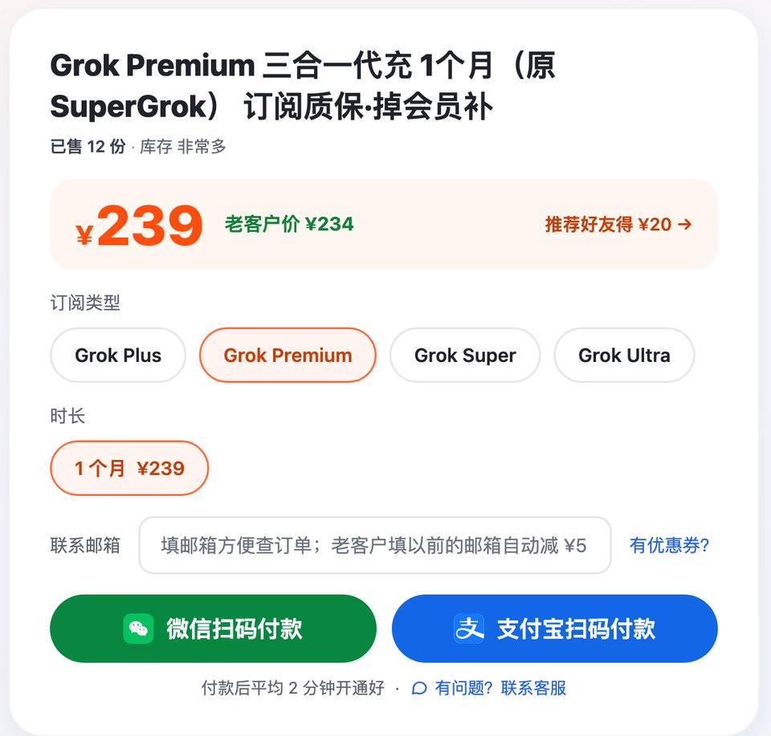
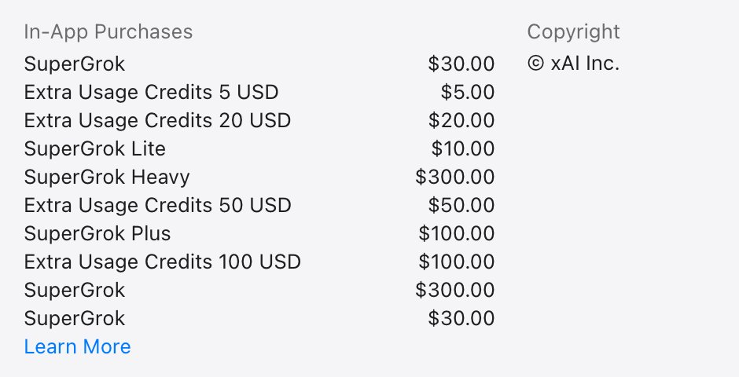

# Grok订阅 2026：四档会员价格、SuperGrok现在叫什么、怎么选

> 2026-10-30 更新 · 瑶瑶ai训练师（kw.yaoyao.chat 店主）整理 · 文中商城链接为广告

**先说结论：** 想开 Grok 会员又没有海外卡，瑶瑶ai训练师的商城能直接开 [Grok订阅 Premium ¥239](https://kw.yaoyao.chat/item/10?d=premium&utm_source=github&utm_medium=readme&utm_campaign=grok&utm_content=top)。支付宝、微信付款，贴一段 sso 登录代码，不要密码，平均 2 分钟开到你原来的账号；没开成重开或退款，本期内掉了会员补一个月。下单填券码 **888888** 再减 ¥3。

- **SuperGrok 现在叫 Premium**：10 月 12 日改版后的新名字，别和 Super（100 美元）买混；原来的 SuperGrok Heavy 定价页已不列。
- **四档官方月费**：Plus 8、Premium 30、Super 100、Ultra 200 美元，不含税（x.ai/pricing）。
- **怎么选**：天天用选 Premium，只要 X 蓝标选 Plus，一周就用光再升 Super。
- **谁不用买**：手里的卡在 grok.com 付得了款，官网自己订最稳；已是付费会员的，等到期再来。
- **ChatGPT 也想开的**：Grok 之外，这家店出单最多的是 [ChatGPT会员 ¥129 一个月](https://kw.yaoyao.chat/item/5?utm_source=github&utm_medium=readme&utm_campaign=grok&utm_content=plus-top)，一样支付宝微信付、不要密码，券码通用。

*图：Grok 选档区（kw.yaoyao.chat/item/10，2026-10-30 截图）*

## 10 月 12 日以后，Grok会员买到的是什么

改版前想拿 Grok 的高额度，得在 grok.com 买 SuperGrok；想要 X 的蓝标，又得在 X 上另买 X Premium。两份订阅各扣各的钱，Grok 的额度还不互通。

xAI 在 2026 年 10 月 12 日发了公告，把这几样并成一个订阅。公告开头是这么写的：

> "Today we're introducing The X Subscription, which brings together Grok, Grok Bot, Cursor, and X Premium in one plan."
>
> 意思是：推出 The X Subscription，把 Grok、Grok Bot、Cursor 和 X Premium 放进同一个套餐。（[xAI 公告](https://x.ai/news/x-subscription)，2026-10-27 核对）

对买会员的人来说，变的是三件事：

1. **名字换了**。在官网，新用户只能买三合一，SuperGrok 不再单独卖，原来 SuperGrok 那一档现在叫 Premium。公告里对 Premium 的描述是 "The benefits of SuperGrok, Cursor Pro, and X Premium+, previously $90/month combined."：这三样以前分开买每月合计 90 美元，现在打包成 30 美元。
2. **一份钱拿三样**。付费档同时带 Grok 额度、X 会员权益和 Cursor（一个写代码的工具）。X 和 Cursor 不会自己生效，得按官方的"合并账号（Combine accounts）"提示走一遍。只用 Grok 的，这一步可以不管。
3. **老订阅不受影响**。公告原话是 "Nothing changes for existing SuperGrok, Cursor, or X Premium subscribers."。已经在订 SuperGrok 的，照常用；想切到新套餐，在账单设置里自己选，旧套餐没用完的钱按比例退。

## Grok价格表：五档官方月费、额度和适合谁

| 档位 | 官方月费（美元，不含税） | 额度（Plus = 1 倍） | 官方定价页写的适用人群 | 瑶瑶店里一个月 |
|---|---|---|---|---|
| Free | 0 | 有限 | — | — |
| Plus | 8 | 1 倍 | AI 用得少、主要用 X 的创作者 | ¥70 |
| Premium（原 SuperGrok） | 30 | 4 倍 | 新的 AI 用户 | ¥239 |
| Super | 100 | 15 倍，高峰期优先 | 每天用智能体的人 | ¥749 |
| Ultra | 200 | 50 倍 | 重度用户（power users） | ¥1,499 |

官方价来自 [x.ai/pricing](https://x.ai/pricing)，2026-10-30 核对，不含增值税这类税费，结账时按地区另算。适用人群是定价页常见问题的原话："We recommend Premium for new AI users, Super for daily agent users, and Ultra for power users. Plus is recommended for social creators with limited AI usage." 改版以后 xAI 调得比较勤，下单前最好再打开官方页看一眼。店里的是人民币一口价，以下单页为准。

倍数怎么理解？官方没公布每一档每周能发多少条消息、能生成多少张图，只给了倍数。"Premium 是 4 倍"，说的是额度池是 Plus 的 4 倍大，不是功能多了 4 倍。实际还剩多少，看设置里的显示。

**Plus 和 Premium 差的不只是额度。** 定价页上，Plus 列的是 Grok 聊天、语音、Imagine、Build 和 Cursor 这些，X 那边给蓝标、少一点时间线广告；Grok Bot、最新的 Grok 模型（Latest Grok models）、更快的回复，是从 Premium 起才写进清单的，X 那边也是 Premium 起才在大部分页面去广告（x.ai/pricing，2026-10-30 核对）。说白了，想用上最新模型，Plus 不够。还有个容易看岔的：美区 App Store 里还挂着 100 美元的 SuperGrok Plus，跟现在 8 美元的 Plus 不是一个东西，别按名字对。

## SuperGrok、Super、Grok Heavy：三个名字别买错

Grok 的档位名改过一轮，网上新旧文章混在一起，下面三个名字最容易让人花冤枉钱。

**SuperGrok**：改版前 grok.com 卖的 Grok 会员。官网定价页上，新用户已经看不到这个名字，它对应的是 Premium，每月 30 美元。搜"supergrok"想开会员的，直接看 Premium 就对了。产品页 x.ai/grok 和美区 App Store 10-30 还在用 SuperGrok 这个叫法，网页上订，以定价页列的四档为准。

**Super**：改版后新加的一档，每月 100 美元，额度是 Plus 的 15 倍，外加高峰期优先。跟 SuperGrok 只差一个词，价格却是 Premium 的三倍多。有人把"SuperGrok"简称成"Super"，付款前多问一句：官方月费是 30 美元还是 100 美元。

**Grok Heavy**：2025 年 7 月 Grok 4 发布时，xAI 加了一档 SuperGrok Heavy，主打 Grok 4 Heavy：同时琢磨好几种思路，再合成一个答案（官方原话 "consider multiple hypotheses at once"，[x.ai/news/grok-4](https://x.ai/news/grok-4)）。10 月 12 日改版以后，几处官方页面说法不一，2026-10-30 打开看到的是：

- x.ai/pricing 只列 Free、Plus、Premium、Super、Ultra，找不到 Heavy，个人最高一档是 Ultra（200 美元）；
- x.ai/grok 产品页把"几个智能体并行回答难题"叫 Multi-agent，写的是 "Upgrade to SuperGrok for higher limits and multi-agent reasoning"，没说新四档从哪一档起有；
- 美区 App Store 的 Grok 内购列表里，还挂着 300 美元的 SuperGrok Heavy。

冲着 Heavy 去的，先登录 grok.com，看模型选择里有没有多智能体那一项，再决定买哪档。碰到还按老价格卖"SuperGrok Heavy"的，问清楚开出来到底显示什么。

## 额度怎么用：一个池子，每周刷新

- **大家共用一个池**。Grok 的聊天、生图、视频、语音、Grok Bot，再加上 Cursor，扣的都是同一个额度池。公告的说法是 "Paid plans on The X Subscription include a generous pool of Grok model usage shared across Grok and Cursor."。
- **每周刷新一次**。Cursor 文档写的是 "It refreshes weekly, so one heavy day doesn't use up your month."：某一天用得猛，不会把整个月的额度一口气用光。
- **用完了怎么办**：按官方方式加购，或者等下周刷新。剩多少、哪天重置，设置里都看得到。
- **图片和视频更耗额度**。生图做视频多的人，Premium 也可能撑不满一周。

除了池子大小，几档在 Cursor 里还有几处功能差别（Cursor 文档《Pricing》《Legacy Cursor plans》，2026-10-27 核对）：

| 在 Cursor 里 | Plus | Premium 及以上 |
|---|---|---|
| Fast 模式 | 没有 | 有，按 2 倍扣额度 |
| 能用的模型 | 只有 Grok 模型 | Grok 模型不额外收费；Claude、GPT 这类第三方模型能选，但按 API 标价另付 |
| 对应原来的 Cursor 套餐 | — | Premium 对应原 Pro，Super 对应原 Pro+，Ultra 对应原 Ultra（官方说是"最接近的档位，不是完全相同"） |

## 按用法挑档位

| 你的用法 | 建议 | 原因 |
|---|---|---|
| 偶尔问问题、看看热点 | 先用 Free 一周 | 记下多久碰一次上限，再决定买不买 |
| 主要刷 X、想要蓝标，AI 用得少 | Plus | 官方推荐给这类创作者；额度只有基础一份，Grok Bot 和最新模型要 Premium 起才有 |
| 每天用 Grok 聊天、查实时信息、偶尔生图 | Premium | 原来 SuperGrok 用户习惯的那一档，官方也推荐新用户选它 |
| 天天生图做视频，或者 Cursor 写代码多 | 先买 Premium，一周就用光再升 Super | Super 是 15 倍额度，高峰期优先 |
| 跑智能体，用量接近一个小团队 | Ultra | 50 倍额度，个人一般用不到 |
| 只想在自己的程序里调用 Grok | 不买会员，用 API | API 是开发者按用量付费的另一套账户，和会员分开算 |

拿不准，就先买一个月 Premium。反正按月买，下个月发现不够再换高一档，比一上来就押最贵的稳当。

## 官方怎么订：网页、手机和三条规矩

**网页订阅**：在 grok.com 或 x.ai 登录，选套餐，付款。定价页常见问题写明自助订阅支持主流的信用卡和借记卡（2026-10-30 核对），结账页没有支付宝、微信。国内发行的卡经常付不过去，很多人就是卡在这儿才转去找代充的。

**手机 App**：中国大陆区 App Store 里没有 Grok，apps.apple.com/cn 的 Grok 页面打开是 404（2026-10-30）。美区 App Store 能下载，内购列表写的还是 SuperGrok 系列，像 SuperGrok 30、SuperGrok Plus 100、SuperGrok Heavy 300 美元，跟官网新四档的名字和价格都对不上；在 App 里订到的是哪一档，以 App 内结账页为准。定价页本身建议只在官网购买。在手机商店订的，取消和退款都要找苹果或谷歌，网页上管不了；网页和 App 各订一份，会重复扣费。

*图：美区 App Store 的 Grok 页面截图（版权署名 xAI Inc.），内购列表里 SuperGrok 30、SuperGrok Plus 100、SuperGrok Heavy 300 美元都还在（apps.apple.com/us/app/grok-ai/id6670324846，2026-10-30 截图）*

订之前，记住三条规矩：

1. **至少提前 24 小时取消**。官网订阅到期会自动续费（官网可选按月或按年付，以 x.ai/pricing 为准），官方写明要在续费前至少 24 小时取消，下一期才不会被扣。
2. **X 和 Cursor 要合并账号才生效**。按官方《Unify accounts》文档，在电脑浏览器打开 cursor.com/unify 或 accounts.x.ai/unify，按提示走。几个账号的邮箱不需要一样，但合并是永久的，做完撤销不了（[docs.x.ai](https://docs.x.ai/x-subscription/unify-accounts)，2026-10-27 核对）。另外，只在 Cursor 里用 X 账号登录，不算合并。
3. **官方只认自己卖的**。xAI 定价页写明订阅只由官方直接销售，不授权任何经销商或第三方卖家，从别的来源买到的订阅可能被暂停或终止（2026-10-30 核对）。代充也在这一条里，下一节说清楚。

## 没有海外卡：在瑶瑶店里开 Grok会员

kw.yaoyao.chat 是瑶瑶ai训练师自己经营的会员代充商城，Grok 四档都能开。前提先摆在这儿：商城是第三方，不是 xAI，按上面 xAI 的说法属于未授权渠道。介意这一点的，请走官方订阅。

- **价格**：四档在同一个下单页选，Plus ¥70 / Premium ¥239 / Super ¥749 / Ultra ¥1,499，实际以下单页为准。冲着原来那档去的，打开 [SuperGrok（现 Premium）¥239](https://kw.yaoyao.chat/item/10?d=premium&utm_source=github&utm_medium=readme&utm_campaign=grok&utm_content=mid)；要更高额度的，打开 [Grok Super ¥749 / Ultra ¥1,499](https://kw.yaoyao.chat/item/10?d=super&utm_source=github&utm_medium=readme&utm_campaign=grok&utm_content=mid2)。
- **账号条件**：账号眼下不是付费会员（免费版）就能开，不看升级页有没有首月半价优惠（2026-10-27 起不再要求这一条）。眼下开着 Plus、Premium 或老 SuperGrok 的，先别下单，等到期变回免费版再来。
- **认准登录方式**：Grok 能用 X、Google、Apple、邮箱登录，换一种方式进去，看到的可能是另一个号；开好后，用下单时那种方式登录再看。
- **怎么开**：付完款，把 sso 登录代码贴进订单页（电脑浏览器登录 grok.com 后，从开发者工具的 Cookies 里复制），不要密码、不要验证码，平均 2 分钟开到你自己的账号。
- **不会自动续费**：不绑你的卡，到期会员自然结束，想接着用再买。
- **售后**：没开通成功，重新开通或退款；开通以后、这一期会员还没到期就掉回免费版（订阅被撤销），拿订单号和截图来，同一个账号再补一个月；账号被封、被停用不属于质保，也不退款。
- **客服和发票**：客服全天 24 小时，只认瑶瑶本人的企业微信（`kw.yaoyao.chat/wecom`）；可开发票，可对公转账。
- **谁在卖**：瑶瑶ai训练师 2023 年 10 月开始做 AI 科普；按商城 2026-10-30 的数据，全站近 30 天开通 402 单。
- **顺手开 ChatGPT**：Grok 之外，店里用的人最多的是 ChatGPT Plus（¥129 一个月）。Plus 能干什么、买几个月合适，看 [ChatGPT Plus购买指南](https://github.com/yaoyao-chat/plus)。

## 常见问题

### SuperGrok 现在还能买吗？多少钱？

官网定价页上，新用户看到的是 Plus、Premium、Super、Ultra 四档，原来的 SuperGrok 对应 Premium，每月 30 美元（不含税）。美区 App Store 的内购列表 10-30 还写着 SuperGrok 系列，在 App 里能订到什么，以 App 内显示为准。已经在订的老用户不受影响，可以继续用到期。

### Grok会员和 X 会员还要分开买吗？

不用。10 月 12 日以后新订的付费档都带 X 会员权益，Premium 带的是 X Premium+ 那一级。要按官方提示把 X 账号和订阅合并，蓝标这些权益才会生效。

### Grok价格以哪里为准？会变吗？

以 x.ai/pricing 当天的显示为准。官方价不含税，结账时按地区另算。改版后 xAI 调整比较频繁，本文的数字是 2026-10-30 核对的。

### Grok Heavy 还能买吗？现在在哪一档？

它原来叫 SuperGrok Heavy，主打几个智能体一起想。官网定价页 10-30 已经不列它，个人最高是 Ultra（200 美元）；美区 App Store 还挂着 300 美元的 SuperGrok Heavy。新四档里哪一档能用多智能体，官方没写明，以 grok.com 里的模型选项为准。

### Grok订阅会自动续费吗？在哪取消？

官网和手机商店订的都会自动续费，官网还可以选按年付。网页订的，在 grok.com 的订阅设置里取消，官方要求至少提前 24 小时；手机商店订的，去 iPhone 或 Google Play 的订阅管理里取消。代充开的不绑你的卡，不会自动扣钱。

### 已经是 SuperGrok 老用户，要不要切到三合一？

不急。官方说老订阅什么都不变。真要切换，旧的 SuperGrok、X Premium、Cursor 订阅会在结账时取消，没用完的钱按比例退；切换和合并账号都是永久的，想清楚再点。

### Grok会员能几个人一起用吗？

不建议。额度按账号算，几个人分一个池子很快见底；多地同时登录容易触发风控，聊天记录也会被所有人看到。

### 买了 Premium，Cursor 怎么用上？

在电脑浏览器打开 cursor.com/unify，用 Cursor 账号登录后，按提示加入你的 Grok 或 X 账号，逐个登录确认。合并完在 Cursor 里退出再登录一次，设置页出现剩余用量和重置时间，就说明已经生效。

## 相关教程

- [ChatGPT Plus购买指南：GPT会员有什么、买几个月](https://github.com/yaoyao-chat/plus)
- ChatGPT、Claude、Gemini 怎么开，瑶瑶ai训练师都写进了 [yaoyao-chat 合集仓库](https://github.com/yaoyao-chat/yaoyao-chat.github.io)
- 想拿 Grok 的月费跟 ChatGPT 比一比，各地区官方价都列在 [ChatGPT价格表](https://github.com/yaoyao-chat/jiage)

想直接下单的，进去默认帮你选在 Premium，另外三档同页切换：[Grok会员 Plus ¥70 / Premium ¥239 / Super ¥749 / Ultra ¥1,499](https://kw.yaoyao.chat/item/10?d=premium&utm_source=github&utm_medium=readme&utm_campaign=grok&utm_content=end)。结账填 **888888** 还是减 ¥3，全店都能用，不跟推荐码、老客户减 ¥5 叠着算。

## 核对与来源

本文 2026-10-30 按下面这些官方页面整理，括号里写的是最近一次打开看的日期；x.ai/pricing 上那些数字，2026-10-30 当天又在浏览器里重新对过一遍。

- xAI 价格页 https://x.ai/pricing （五档月费、额度倍数、各档适用人群原文、Plus 和 Premium 功能清单、页面不再列 Heavy、付款方式、续费前 24 小时取消、不授权第三方卖家：2026-10-30）
- xAI 公告《Grok 4》 https://x.ai/news/grok-4 （2025-07-09 发布；SuperGrok Heavy 档、Grok 4 Heavy、"consider multiple hypotheses at once"：2026-10-30）
- xAI 产品页 https://x.ai/grok （Multi-agent、"Upgrade to SuperGrok for higher limits and multi-agent reasoning"、页面无 Heavy 字样：2026-10-30）
- 美区 App Store 的 Grok 页 https://apps.apple.com/us/app/grok-ai/id6670324846 （内购列表 SuperGrok 30、SuperGrok Lite 10、SuperGrok Plus 100、SuperGrok Heavy 300 美元等：2026-10-30）；中国大陆区 https://apps.apple.com/cn/app/grok/id6670324846 （打开 404：2026-10-30）
- xAI 公告《The X Subscription》 https://x.ai/news/x-subscription （改版日期、三合一内容、Premium 原话、老订阅不变：2026-10-27）
- xAI 文档《Unify accounts》 https://docs.x.ai/x-subscription/unify-accounts ，以及《Sign-in》 https://docs.x.ai/x-subscription/sign-in （怎么合并账号、合并后永久撤销不了：2026-10-27）
- Cursor 官方价格页 https://cursor.com/pricing ，文档《Pricing》 https://cursor.com/docs/account/pricing ，《Legacy Cursor plans》 https://cursor.com/docs/account/pricing/legacy-cursor-plans （每周刷新、Fast 模式、第三方模型另付、新旧档位怎么对应：2026-10-27）
- 瑶瑶店里的价格、售后、客服、开票：商城数据库 2026-10-30 03:59 导出的事实卡；账号条件（免费版就能开、2026-10-27 起不看首月半价）和登录方式提醒：商城 Grok 下单页和 Grok 教程页（2026-10-30 打开核对）

## 关于作者与声明

这篇出自瑶瑶ai训练师之手，她 2023 年 10 月开始做 AI 科普，全网粉丝大约 320 万。整理的人就是 kw.yaoyao.chat 的店主，文中的商城链接全部是自家店的广告。代充不是官方渠道，瑶瑶的店跟 xAI 没有隶属关系，xAI 也没有授权过它。任何人找你要密码或验证码，哪怕说自己是瑶瑶客服，都别给；客服只有企业微信一个，`kw.yaoyao.chat/wecom`。
